# MiniAppRuntime-Harmony


一个受小程序运行时架构启发的 HarmonyOS Web 容器与 JSBridge 框架，由可复用 ArkTS Runtime、H5 SDK 和独立消费 Demo 组成。

项目只使用 HarmonyOS、ArkTS 与 ArkWeb 公开能力，聚焦 H5 与 Native 双向通信、API 注册分发、Biz/Imp 分层、异步生命周期和可观测性。

## 快速体验

**第一次使用或已经忘记接入步骤：先按[从新建工程跑通 Runtime](docs/getting-started/quick-start.md)操作。** 该路径提供纯 HTML 页面、SDK 同步脚本、完整 `UIAbility`/`Index.ets` 和每一步的成功标准；通路成功后再接 React。

当前 `myascf_runtime@1.0.0` 发布包要求最低兼容 API **23**，消费工程和设备均需满足要求。官方 ASCF 模板需要先调整启动入口，详见[Windows 初始化与真机验收](docs/guide/windows-initialization.md)。

以下代码是 API 摘要；安装包后还需要创建 H5 资源、配置页面启动和 Proxy。

在消费工程根安装 H5 SDK：

```bash
npm install @lcy453/miniapp-runtime-harmony-web-sdk@0.1.0
```

在消费工程的 `entry` 目录安装 HarmonyOS Runtime：

```bash
ohpm install myascf_runtime@1.0.0
```

纯 HTML 最小示例配置完成后，在消费工程根执行 `npm run sync:runtime-web`，将页面和 SDK 复制到 `rawfile/web`，再在 DevEco 构建运行。以后修改 `h5/index.html` 或更新 SDK，也要同步后重新构建运行；完整 `package.json` 和[再次上手步骤](docs/getting-started/quick-start.md#下次继续开发修改--同步--构建--运行)见快速开始。

H5 调用：

```ts
import { createTypedApi, initMyASCF } from '@lcy453/miniapp-runtime-harmony-web-sdk';

const api = createTypedApi(initMyASCF());
await api.ui.showToast({ message: 'hello from H5' });

const response = await api.network.request({
  url: 'https://example.com/api',
  method: 'GET',
  responseType: 'json'
});
console.log(response.data?.statusCode, response.data?.ok);
```

ArkTS 容器：

```ts
import { webview } from '@kit.ArkWeb';
import { MyASCFRuntime } from 'myascf_runtime';

private controller: webview.WebviewController = new webview.WebviewController();
private runtime: MyASCFRuntime = new MyASCFRuntime(
  this.controller,
  getContext(this)
);

Web({ src: $rawfile('web/index.html'), controller: this.controller })
  .javaScriptAccess(true)
  .javaScriptProxy({
    object: this.runtime.getNativeProxy(),
    name: this.runtime.getProxyName(),
    methodList: this.runtime.getMethodList(),
    controller: this.controller
  })
```

完整接入步骤见 [Quick Start](docs/getting-started/quick-start.md) 和 [ArkWeb Integration](docs/guide/arkweb-integration.md)。

2026-10-10 已在 API 24 真机验证纯 HTML 最小通路：Toast、9 个 API 的动态列表、Storage 写入/读回和 Network GET 200。Clipboard、取消和网络错误矩阵仍需按手工清单回归。

## 架构

```mermaid
flowchart LR
  H5["H5 App"] --> SDK["H5 SDK"]
  SDK --> Proxy["MyASCFNative.postMessage"]
  Proxy --> Controller["BridgeController"]
  Controller --> Dispatcher["BridgeDispatcher"]
  Dispatcher --> Registry["HandlerRegistry"]
  Registry --> Biz["Biz"]
  Biz --> Imp["Imp / HarmonyOS Kit"]
  Imp --> Callback["BridgeCallbackExecutor"]
  Callback --> Promise["H5 Promise"]
```



`MyASCFRuntime` 在 HAR 内组装 Registry、Dispatcher、CallbackExecutor、Controller、Native Proxy 和内置 API；示例应用只负责 ArkWeb、页面资源与代理注入。

## 能力

- `requestId`、callback map、Promise resolve/reject
- JavaScriptProxy 与 `runJavaScript` 双向通信
- Dispatcher / Registry 与 Biz / Imp 分层
- Runtime 超时、SDK 超时、callback lost 和 AbortController 取消
- Toast、Clipboard、Storage、Network 与动态 API Manifest
- DebugPanel、敏感字段脱敏和调用链日志
- ArkWeb 加载状态、URL 白名单与错误页
- IIFE / ESM H5 SDK、TypeScript 类型和 npm/OHPM 双包边界

## 公开 API

下表由 `tools/api-manifest.json` 自动生成，内部 `network.abort` 不对外展示。

<!-- API_TABLE_START -->
| Category | Action | Params | Response | Status |
| --- | --- | --- | --- | --- |
| runtime | `runtime.getApiList` | - | `apis: ApiSummary[]` | Implemented |
| ui | `ui.showToast` | `message: string` | `echoAction: string` | Implemented |
| system | `system.clipboard.writeText` | `text: string` | `echoAction: string` | Implemented |
| system | `system.clipboard.readText` | - | `echoAction: string, text: string` | Implemented |
| system | `system.storage.setItem` | `key: string, value: string` | `echoAction: string, key: string, value: string` | Implemented |
| system | `system.storage.getItem` | `key: string` | `echoAction: string, key: string, value: string` | Implemented |
| system | `system.storage.removeItem` | `key: string` | `echoAction: string, key: string` | Implemented |
| system | `system.storage.clear` | - | `echoAction: string` | Implemented |
| network | `network.request` | `url: string, method?: NetworkMethod, headers?: NetworkHeaders, body?: string, timeout?: number, responseType?: NetworkResponseType` | `ok: boolean, statusCode: number, statusText?: string, headers: NetworkHeaders, body: NetworkBody, duration: number` | Implemented |
<!-- API_TABLE_END -->

`network.request` 采用 Fetch 风格语义：收到有效 HTTP 响应即 resolve，HTTP 是否成功由 `data.ok` 与 `data.statusCode` 判断；连接失败和网络超时才 reject。

## 包与版本

| 包 | 当前版本 | 分发方式 | 作用 |
| --- | --- | --- | --- |
| `@lcy453/miniapp-runtime-harmony-web-sdk` | `0.1.0` | npm | H5 Promise、类型化 API、超时与取消 |
| `myascf_runtime` | `1.0.0` | OHPM | ArkTS Bridge、分发注册、平台能力与回调 |

仓库内 `entry` 使用源码模块联调；[`examples/npm-har-consumer-demo`](examples/npm-har-consumer-demo/README.md) 使用公开 npm 与 OHPM 包验证真实消费边界。

## 项目结构

```text
entry/                         仓库内 HarmonyOS 示例与 rawfile H5
myascf_runtime/                可发布 ArkTS HAR Runtime
h5_sdk/                        可发布 H5 SDK，含 IIFE/ESM/类型
examples/npm-har-consumer-demo 独立 React + HarmonyOS 消费示例
tools/                         Manifest、类型、文档与一致性检查
docs/                          教程、概念、API、排错、发布与文章
```

## 文档

- [文档首页](docs/README.md)
- [项目介绍](docs/getting-started/introduction.md)
- [架构概览](docs/getting-started/architecture-overview.md)
- [H5 SDK 安装](docs/guide/h5-sdk-installation.md)
- [Runtime 安装](docs/guide/runtime-installation.md)
- [API Reference](docs/api/README.md)
- [完整 React 示例](docs/examples/complete-react-app.md)
- [排错目录](docs/troubleshooting/native-unavailable.md)
- [v1.0.0 发布说明](docs/release/v1.0.0.md)
- [文章目录](docs/articles/README.md)

## 验证

```bash
npm run check
npm --prefix h5_sdk run check
```

自动检查覆盖 API Manifest、注册关系、生成文档、SDK 构建与测试、包导出、npm pack 以及独立 React Demo 类型检查。ArkWeb、权限和平台 API 的真实行为仍需使用 DevEco Studio 与测试设备完成手工冒烟测试。

## 边界

这是个人开源学习与工程实践项目，不包含任何非公开源码、内部接口、内部模块名或内部文档。当前目标是提供清晰、可验证的轻量级运行时链路，不宣称是完整小程序平台或生产级安全沙箱。

## License

[MIT](LICENSE)
