# 架构总览

你将学会什么：一次 API 调用怎样穿过 H5 SDK、ArkWeb 和 ArkTS Runtime，再回到原来的 Promise。

```mermaid
flowchart LR
  H["React / Vue / H5"] --> S["npm H5 SDK"]
  S --> N["window.MyASCFNative.postMessage"]
  N --> J["ArkWeb JavaScriptProxy"]
  J --> C["BridgeController"]
  C --> D["BridgeDispatcher"]
  D --> R["HandlerRegistry"]
  R --> B["Biz"]
  B --> I["Imp / HarmonyOS Public API"]
  I --> E["BridgeCallbackExecutor"]
  E --> P["runJavaScript"]
  P --> M["callback map / Promise"]
```

H5 SDK 生成 requestId，把 `{ requestId, action, params }` 交给 NativeAdapter。ArkWeb 注入的 `MyASCFNative.postMessage` 把 JSON 字符串送入 `JavaScriptProxy`。

`BridgeController` 解析协议，`BridgeDispatcher` 从 `HandlerRegistry` 找到 handler，Biz 校验参数并构造统一响应，Imp 调用公开 HarmonyOS API。`BridgeCallbackExecutor` 通过 `runJavaScript` 调用 `window.__myascf_on_native_response__`，SDK 再按 requestId settle Promise。

Manifest 驱动公开 API 表、TypeScript 类型、nested helper、`runtime.getApiList` 和一致性检查。

## 下一步阅读

- [requestId 与 callback map](../concepts/request-id-and-callback-map.md)
- [Dispatcher 与 Registry](../concepts/dispatcher-and-registry.md)
- [BridgeResponse](../concepts/bridge-response.md)
